# ListManager

ListManager is a shared shopping list for a household or a small shop team. You say what you
need in Romanian, the Android app matches each spoken phrase to a product in the catalog on the
phone itself, and the item lands on a list that everyone in the team sees change live. In the
shop it keeps working without a connection and syncs when the signal comes back. When the list
is done, it becomes one order PDF per distributor.

The repository holds three parts: a FastAPI backend, the native Android app (the complete
client), and a smaller Flutter client on the same API.

## Use cases

- **Dictate a shopping list in Romanian.** Tap the microphone and speak; the app uses Android's
  speech recognizer in `ro-RO` (`data/speech/AndroidSpeechProvider.kt`), splits the phrase into
  products and quantities ("două lapte" → Lapte Zuzu 1L × 2), and ranks catalog products on the
  device. A clear match is added; when two products are close, a sheet asks which one you meant.
- **One list for the whole household or team, live on every phone.** A list belongs either to
  you or to a team. Every add, quantity change and removal is pushed to the other members'
  phones over a WebSocket (`/ws`), so two people shopping from the same list see the same thing.
- **Shop offline.** Changes made without a connection go into an outbox on the phone (Room +
  WorkManager) and are sent when the network returns. Writes carry a version number; if someone
  else changed the same item in the meantime, the server answers 409 and the change is held on a
  "decide" screen where you keep your version or theirs, instead of one silently overwriting
  the other.
- **Turn the list into orders.** Completing a list groups its items by distributor and the app
  writes one PDF order per distributor, ready to share.
- **Keep the catalog and an inventory.** Browse and search products by distributor; admins add
  and edit products and distributors. A separate inventory screen counts stock by voice
  ("lapte zuzu 5 4 lei 50" → product, quantity, price), totals it and exports it as a PDF.
- **Teams and administration.** Create a team, invite people with a code, and switch between
  your personal list and a team's. Admins get a web dashboard (`/admin`) and endpoints to import
  the catalog, see users, orders and sign-in events, change roles and revoke tokens.

## UI

The Android app's interface is in Romanian. These are not photos from a phone: they are renders
from the app's Robolectric UI tests (`android-native/app/src/testDebug/.../ui/`) on a
412×915 dp phone viewport, with test data.

<table>
  <tr>
    <td align="center" width="33%">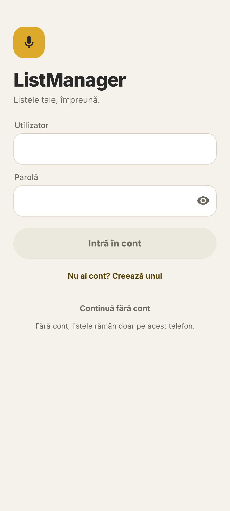<br><sub><b>Sign in</b> — or continue without an account; lists then stay on this phone.</sub></td>
    <td align="center" width="33%">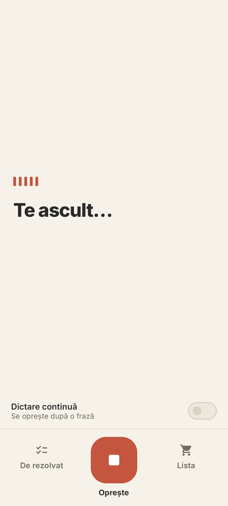<br><sub><b>Dictate</b> — "Te ascult…" while the recognizer listens; continuous dictation is a switch.</sub></td>
    <td align="center" width="33%">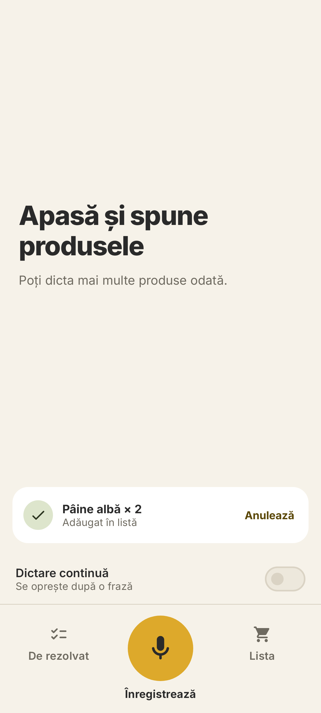<br><sub><b>Added</b> — a clear match goes straight onto the list, with an undo.</sub></td>
  </tr>
  <tr>
    <td align="center">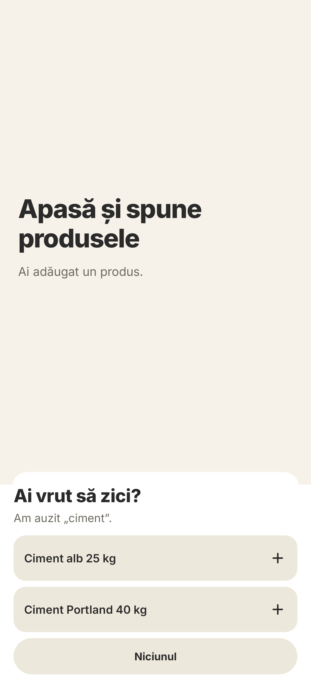<br><sub><b>"Ai vrut să zici?"</b> — when two products are close, you pick one or none.</sub></td>
    <td align="center">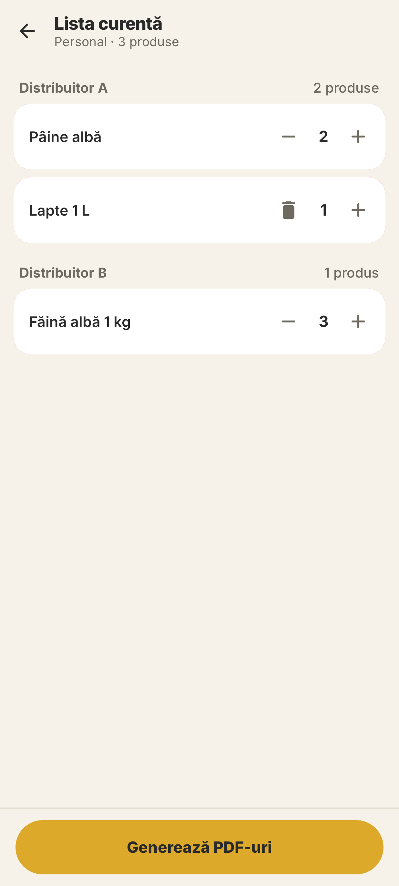<br><sub><b>The list</b> — grouped by distributor, with quantity controls.</sub></td>
    <td align="center">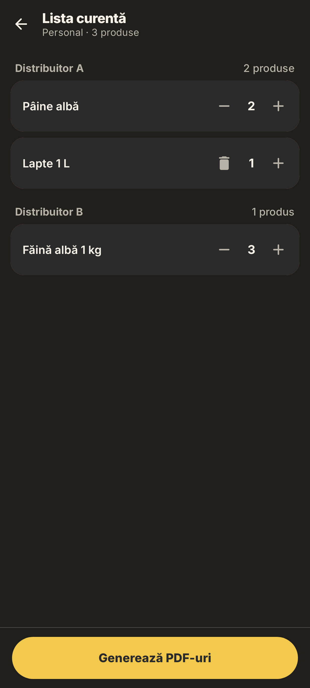<br><sub><b>Dark theme</b> — the same list.</sub></td>
  </tr>
  <tr>
    <td align="center">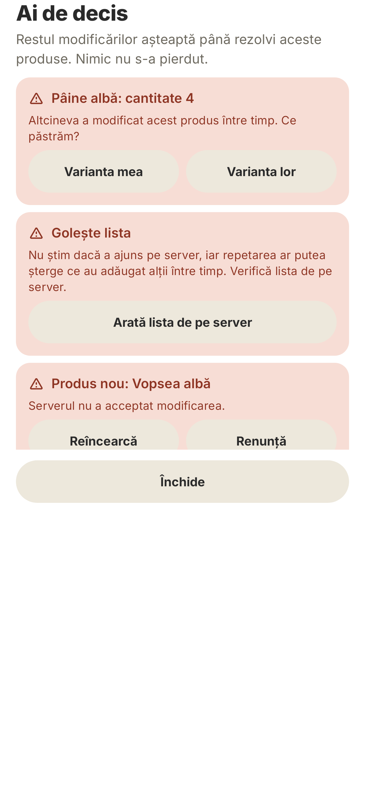<br><sub><b>"Ai de decis"</b> — offline changes the server refused or that clash with someone else's; keep yours or theirs.</sub></td>
    <td align="center">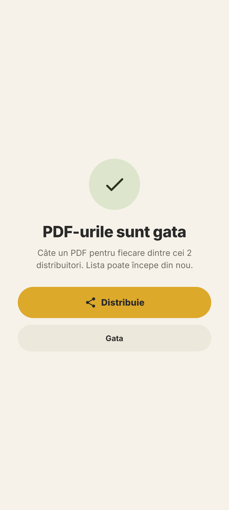<br><sub><b>PDFs ready</b> — one PDF per distributor, to share.</sub></td>
    <td align="center">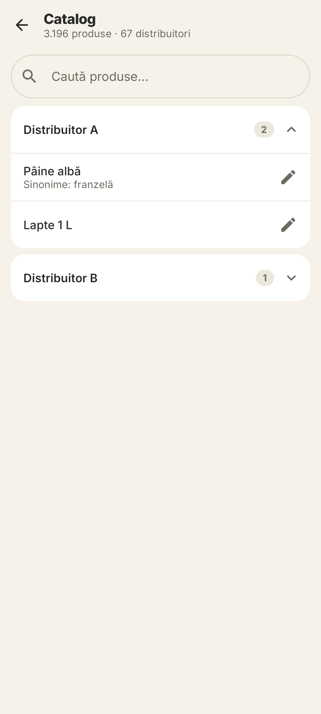<br><sub><b>Catalog</b> — products by distributor, with synonyms; admins can edit.</sub></td>
  </tr>
  <tr>
    <td align="center">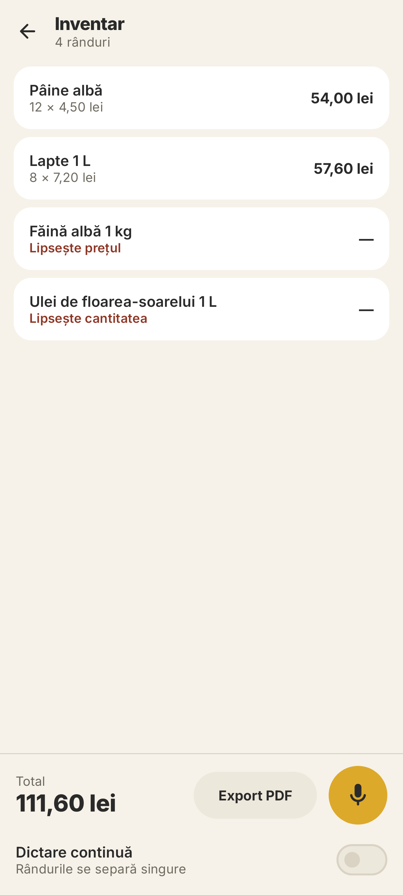<br><sub><b>Inventory</b> — dictated rows with quantity and price, a total, and PDF export.</sub></td>
    <td align="center">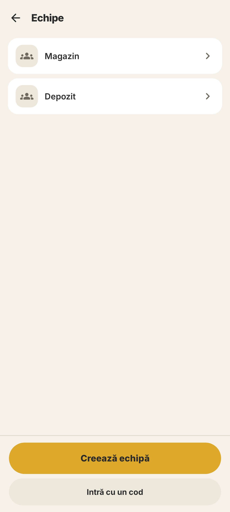<br><sub><b>Teams</b> — create a team or join one with a code.</sub></td>
    <td align="center">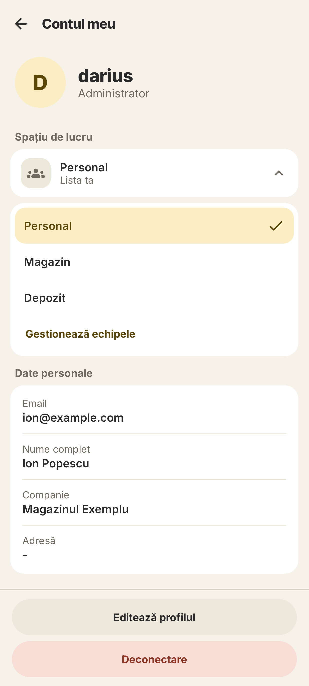<br><sub><b>Workspace</b> — switch between your personal list and a team's.</sub></td>
  </tr>
</table>

## Stack

| Part | Technology | Version (from the build files) |
| --- | --- | --- |
| **Android app** (`android-native/`) | Kotlin | 2.1.0 |
| | Android Gradle Plugin | 8.13.0 |
| | SDK levels | min 34, target 35, compile 36 |
| | Jetpack Compose (BOM) / Material 3 | 2024.09.00 / 1.4.0 |
| | Navigation Compose | 2.9.5 |
| | Room (local database, outbox) | 2.8.1 |
| | WorkManager (background sync) | 2.9.0 |
| | Retrofit / OkHttp | 2.9.0 / 4.12.0 |
| | kotlinx.coroutines / kotlinx.serialization | 1.10.2 / 1.6.0 |
| | ONNX Runtime + `sentence-embeddings` (paraphrase-multilingual-MiniLM-L12-v2) | 1.24.3 / v6 |
| | Firebase App Distribution (test builds and in-app updates) | 16.0.0-beta21 |
| **Backend** (`backend-fastapi/`) | Python | 3.11.9 (Render) |
| | FastAPI / Uvicorn | 0.162.0 / 0.27.0 |
| | SQLAlchemy / Alembic | 2.0.25 / 1.13.1 |
| | PostgreSQL in production (psycopg2), SQLite in development | psycopg2-binary 2.9.9 |
| | Pydantic | 2.14.3 |
| | Auth: JWT (PyJWT, HS256) with rotating refresh tokens, bcrypt | PyJWT 2.15.1, bcrypt 4.0.1 |
| | Real-time: WebSocket (`websockets`) | 12.0 |
| | Rate limiting: slowapi | 0.1.9 |
| | Tests: pytest / httpx | 9.2.0 / 0.28.1 |
| **Flutter client** (`flutter_ui/`) | Dart SDK constraint | ^3.9.2 |
| | `http` / `web_socket_channel` / `flutter_secure_storage` | ^1.2.2 / ^3.0.1 / ^9.2.2 |
| **Hosting** | Render (web service, PostgreSQL, daily backup cron job) | `backend-fastapi/render.yaml` |
| | Cloudflare R2 (daily `pg_dump` backups) | `ops/db-backup/` |
| | Firebase App Distribution (Android builds to testers) | `.github/workflows/android-distribute.yml` |

### Voice matching on the phone

There is no matching on the server. The ranker lives in the Android app:
`android-native/app/src/main/java/com/darius/listmanager/util/ProductRanker.kt`, with
`SimilarityEngine.kt`, `TextNorm.kt` and `QueryVariants.kt`. It blends Levenshtein, Jaccard,
token, phonetic, prefix, contains and number-sequence scores over product names and aliases.
A bundled multilingual sentence-embedding model (ONNX, `data/embedding/`) adds semantic
candidates; if the model is missing, matching falls back to the fuzzy scores alone
(`app/src/main/assets/README.md`).

## How it works

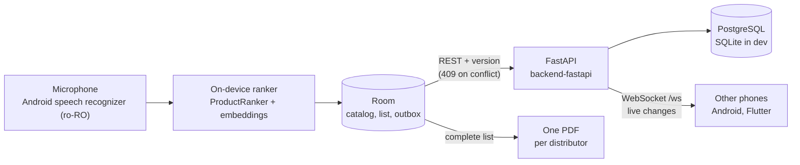

1. The phone keeps a copy of the catalog in Room, so voice matching works offline.
2. Each change to the list is sent to the API with the item's version. Offline, it waits in the
   outbox and WorkManager replays it later.
3. The server applies it, records it in the list's operation log and pushes it to the other
   members over the WebSocket.
4. Completing the list returns the items grouped by distributor, and the app writes the PDFs.

## Repository layout

```
backend-fastapi/   FastAPI app (app/), Alembic migrations (alembic/), tests (tests/), render.yaml
android-native/    Android app: Kotlin, Compose, Room; voice and ranking in app/.../util/
flutter_ui/        Flutter client: sign-in, catalog, shared list, live updates (see its README)
ops/db-backup/     Docker job that dumps PostgreSQL to Cloudflare R2
docs/              Progress log, design notes (sync, speech), audits; docs/images/ for this README
pictures/          Screenshots from October 2025, before the 2026 redesign
```

## Getting started

Commands are for PowerShell on Windows; run each from its own folder.

**Backend**

```powershell
cd backend-fastapi
python -m venv venv
.\venv\Scripts\Activate.ps1
pip install -r requirements.txt
uvicorn app.main:app --reload
```

On startup the app runs `alembic upgrade head` and seeds the catalog and the admin account.
Without `DATABASE_URL` it uses SQLite (`backend-fastapi/listmanager.db`). `SECRET_KEY` and
`ADMIN_PASSWORD` come from the environment; see `backend-fastapi/.env.example`.

**Android**

```powershell
cd android-native
Copy-Item app\src\main\java\com\darius\listmanager\network\ApiConfig.kt.example `
          app\src\main\java\com\darius\listmanager\network\ApiConfig.kt
.\gradlew assembleDebug
```

Builds need JDK 17 and the Android SDK. The embedding model files are not in git; fetch them
as described in `app/src/main/assets/README.md`, or the app runs with fuzzy matching only.

**Flutter**

```powershell
cd flutter_ui
flutter pub get
flutter run --dart-define=API_BASE_URL=http://10.0.2.2:8000
```

### Tests

| Part | Command |
| --- | --- |
| Backend | `cd backend-fastapi; .\venv\Scripts\Activate.ps1; pytest -q` |
| Android unit + Robolectric UI tests | `cd android-native; .\gradlew testDebug` |
| Android instrumented tests (device or emulator) | `cd android-native; .\gradlew connectedAndroidTest` |
| Flutter | `cd flutter_ui; flutter test` |

The UI tests also write the screenshots above to `android-native/app/build/ui-snapshots/`.

## CI/CD and deployment

GitHub Actions workflows live in `.github/workflows/`. The pipeline is adapted from the KlusAI
webos pipeline, and its map is in [`.github/workflows/README.md`](.github/workflows/README.md).
- **CI.** On pull requests and on `development`, CI runs the backend, Android, Flutter and
  contract tests.
  - A suite that runs no tests, or that skips a test without a recorded reason, fails.
  - Every run also checks for committed secrets and AI attribution.
- **Auto-merge.** Pull requests labelled `auto-merge` merge on their own once `ci-ok` passes.
- **Deploy.** Render deploys the backend from `development` once the checks on a commit pass,
  using the Blueprint in `backend-fastapi/render.yaml`. A smoke test then checks production and
  rolls it back if it fails, unless the release migrated the database.
- **Releases.** **Release: tag and notes** tags a green commit (`vYYYY.MM.DD`), writes the
  release notes, and sends the Android build to the phones through Firebase App Distribution.
- **Alerts.** Failures on `development` and in production each open a GitHub issue.

Setup, environment variables, Android release signing and backup/restore steps are in
[DEPLOYMENT.md](DEPLOYMENT.md).

## Further reading

Current:

- [docs/PROGRESS.md](docs/PROGRESS.md) — running log of what changed, what's next, open questions.
- [docs/SYNC_DESIGN.md](docs/SYNC_DESIGN.md) — offline sync and conflicts.
- [docs/SPEECH_DESIGN.md](docs/SPEECH_DESIGN.md) — voice input and matching.
- [flutter_ui/README.md](flutter_ui/README.md) — what the Flutter client does and doesn't do.
- [CLAUDE.md](CLAUDE.md) — working rules and stack notes for this repository.

Background, last changed in February 2026. These describe the app before the 2026 Android
redesign and may not match the current code or UI:

- [APP_DESCRIPTION.md](APP_DESCRIPTION.md) and [APP_DESCRIPTION_SHORT.md](APP_DESCRIPTION_SHORT.md)
- [Short_description_of_application.md](Short_description_of_application.md)
- [README-Project_Ideea.md](README-Project_Ideea.md) — the original project idea
- [How_it_works.md](How_it_works.md) — pending operations
- [Server-side.md](Server-side.md)
